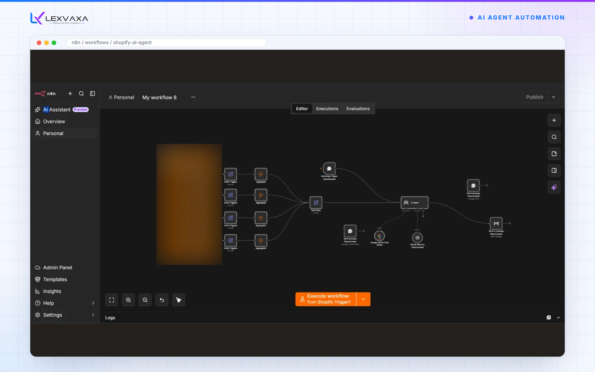

<!-- styled:v2 -->

**An AI agent in n8n that processes store orders, evaluates each task and triggers the right automated action through APIs and messaging.**

  
  
  
  
  
  
  
  

  <a href="#overview">Overview</a> ·
  <a href="#key-features">Key features</a> ·
  <a href="#results">Results</a> ·
  <a href="#tech-stack">Tech stack</a>

---

## Overview

Managing decisions and data across several AI models and external tools was getting hard to maintain. Lexvaxa built an intelligent AI automation system in n8n that processes incoming order data, evaluates each task with an AI agent and triggers automated actions. AI agents, LLMs, webhooks, APIs, memory, search tools and custom logic work together in one workflow. Screens shown use sample data, so no client records are exposed.

## The challenge

Order handling needed decisions across several AI models and tools, which was fragile when wired by hand.

## The solution

An n8n agent workflow with Shopify triggers, aggregation, an AI agent with chat model and memory, search tools and messaging steps, with credentials stored securely.

## Key features

- Multi-model AI processing
- Real-time triggers from store orders
- AI agent with memory and search tools
- API and data integration
- Automated messages and actions

## Results

- A scalable system for intelligent task automation

## Tech stack

     

## Privacy

Client names and records are confidential. Every screen in this repository uses sample data, and source code that belongs to the client is not published.

## Links

- Case study on Lexvaxa: https://lexvaxa.com/work/shopify-ai-agent-automation

---

**Built by [Ch Muhammad Samiullah](https://github.com/samiullah156-creator)** · AI Automation Engineer and Full-Stack Developer at [Lexvaxa](https://lexvaxa.com)

⭐ Star this repo if you found it useful

